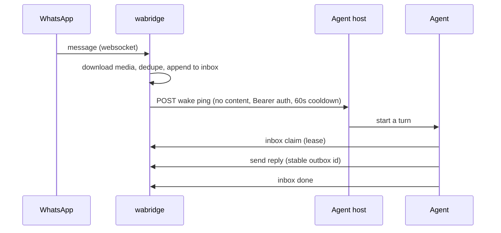

# wabridge

**WhatsApp for AI agents that sleep.**

wabridge links an AI agent to a WhatsApp number as a linked device, keeps every inbound message in a durable local inbox, and wakes the agent with a ping that carries no message content. The agent can sleep, get suspended, or crash mid-turn, and nothing gets lost or answered twice.

Single static Go binary. Built on [whatsmeow](https://github.com/tulir/whatsmeow). MIT.

> ⚠️ wabridge speaks the unofficial WhatsApp Web multi-device protocol. WhatsApp can restrict or ban numbers that behave like bots. Use a dedicated number, keep it conversational, and never message people who didn't write first.

## Why another WhatsApp bridge?

Most WhatsApp-for-agents projects assume the agent's host is always on: a daemon holds the socket, and messages get pushed into a webhook or an in-memory queue. That breaks the moment your agent runs somewhere that pauses when idle (serverless-ish sandboxes, laptops, agent platforms that freeze a VM between turns).

wabridge is built for that world:

- **Durable inbox, not a webhook firehose.** Inbound messages are appended to a per-number JSONL inbox. Consumers claim lines under an expiring lease and mark them done. A crashed run's lines come back on their own.
- **Content-free wake pings.** The webhook says "something is waiting": a count, a timestamp and the ids of chats with pending lines. No message text, no media, no media keys, no names. Message content never leaves the host.
- **Exactly-once-ish delivery.** Dedupe by chat and message id, stable outbox ids, and send retries that reuse the same id so a retry never double-sends.
- **Survives suspend and resume.** Frozen-gap detection reconnects within about a second of resume, every dial and connect has a hard deadline, and a watchdog falls back to exiting for the supervisor instead of wedging.
- **One process per number.** A logout, ban or hang on one number can't take the others down.

## What it handles today

- Inbound: text, media (downloaded before the line is written), edits, deletes-for-everyone, reactions (including encrypted ones), poll votes, contacts, locations, and late offline-sync messages flagged `delayed` (never dropped).
- Voice: inbound voice-note transcription with local whisper.cpp, and outbound voice notes via local TTS.
- Outbound: chunked replies with stable per-chunk ids, quoted replies, forwards, images, documents, typing presence, and phone number to JID resolution.
- Health: a status file with heartbeat and reconnect counters, keepalive and transport watchdogs, supervisor scripts, and a stream-replaced backoff.
- Testing: a replay soak suite over synthetic fixtures. `scripts/soak.sh` must print `soak: OK` before any live restart.

## Quickstart

```sh
go build -o wabridge .

# Link a number (8-character code typed on the phone under Linked devices,
# "Link with phone number instead"). QR also works without --phone.
./wabridge pair --profile mybot --phone <international digits>

# Receive: appends to ~/.whatsapp-bridge/mybot/inbox.jsonl, auto-reconnects
./wabridge run --profile mybot

# Consume: claim pending lines, handle them, mark them done
./wabridge inbox claim --profile mybot          # prints a lease id + messages
./wabridge send --profile mybot --to <number or JID> --text "hi"
./wabridge inbox done --profile mybot --lease <lease id>
```

State lives in `~/.whatsapp-bridge/<profile>/` (mode 700). `session.db` holds the device keys. Treat it like a password and never commit it.

To get wake pings, put the agent host's webhook URL in `~/.whatsapp-bridge/<profile>/webhook_url` and, optionally, a Bearer token in `webhook_key` (both mode 600, read at `run` start). `./wabridge notify-test --profile mybot` sends one test ping.

## Build and test

```sh
go build -o wabridge .     # pure Go; CGO_ENABLED=0 works
go test ./...              # unit tests + replay suite (no network beyond loopback)
scripts/soak.sh            # go vet + replay suite + all tests; must end with "soak: OK"
```

## Docs

- [docs/ARCHITECTURE.md](docs/ARCHITECTURE.md): the generic core vs the agent-platform edge
- [docs/WAKE-CONTRACT.md](docs/WAKE-CONTRACT.md): the ping, claim and ack contract for any agent host
- [docs/USAGE.md](docs/USAGE.md): full command, inbox-line and outbox reference
- [docs/COMPARISON.md](docs/COMPARISON.md): feature and gap table vs wacli

## How the wake loop works



If the host was suspended, WhatsApp holds the messages on its side and delivers them through offline sync when wabridge reconnects after resume.

## Compared to

| | wabridge | [wacli](https://github.com/openclaw/wacli) | [whatsapp-mcp](https://github.com/lharries/whatsapp-mcp) | Baileys-based gateways |
|---|---|---|---|---|
| Library | whatsmeow (Go) | whatsmeow (Go) | whatsmeow + Python | Baileys (Node) |
| Delivery model | Durable inbox + leases | Local store + webhook | Local SQLite + MCP tools | Webhook / in-memory queue |
| Message text in webhook | Never | Yes (optional HMAC signature) | n/a | Usually |
| Survives host suspend | Yes, by design | Not a stated goal | Not a stated goal | Not a stated goal |
| Searchable history | Not yet | Yes, excellent | Yes | Varies |

If you want a full WhatsApp CLI with searchable history and multi-account, use wacli. It's great. wabridge is narrower on purpose: the reliable inbox and outbox loop for an agent that isn't always awake.

## Roadmap

See [issues](https://github.com/benoror/wabridge/issues). The headline items are encrypted session backup, explicit handling for outdated-client, temporary-ban and connect-failure errors, a read-only `doctor` health command, send caps for new numbers, and an MCP server over the inbox and outbox.

## Credits

- [whatsmeow](https://github.com/tulir/whatsmeow) by Tulir Asokan and contributors does the actual hard part: the WhatsApp Web multi-device protocol in Go. wabridge is a thin, opinionated loop on top of it.
- [wacli](https://github.com/openclaw/wacli) inspired the error-handling, read-only and doctor ideas on our roadmap, and its 48-hour dependency delay.
- [whatsapp-mcp](https://github.com/lharries/whatsapp-mcp) showed how much people want WhatsApp inside their agents.

## License

MIT
