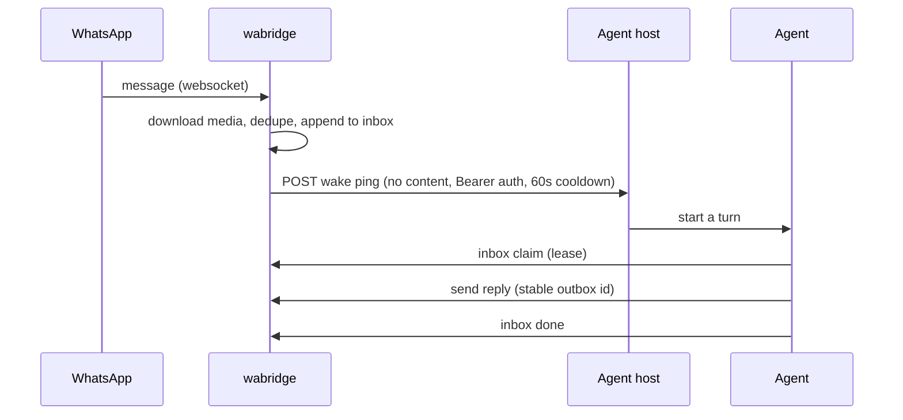

# wabridge

**WhatsApp for AI agents that sleep.**

wabridge links an AI agent to a WhatsApp number as a linked device, keeps every inbound message in a durable local inbox, and wakes the agent with a ping that carries no message content. The agent can sleep, get suspended, or crash mid-turn, and nothing gets lost or answered twice.

Single static Go binary. Built on [whatsmeow](https://github.com/tulir/whatsmeow). MIT.

> ⚠️ wabridge speaks the unofficial WhatsApp Web multi-device protocol. WhatsApp can restrict or ban numbers that behave like bots. Use a dedicated number, keep it conversational, and never message people who didn't write first.

## Why another WhatsApp bridge?

Most WhatsApp-for-agents projects assume the agent's host is always on: a daemon holds the socket, and messages get pushed into a webhook or an in-memory queue. That breaks the moment your agent runs somewhere that pauses when idle (serverless-ish sandboxes, laptops, agent platforms that freeze a VM between turns). wabridge is built for that world.

## Key features

**Core**

- **Fast, single Go binary.** Pure Go (`CGO_ENABLED=0` works), one small process per number, no runtime or database server to install.
- **Durable, persistent inbox.** Every inbound message is appended to a per-number `inbox.jsonl`. Consumers claim lines under an expiring lease and mark them done; a crashed or paused run's lines come back on their own. State survives restarts, crashes and host pauses.
- **Exactly-once-ish delivery.** Dedupe by chat and message id, stable outbox ids, and send retries that reuse the same id, so a retry never double-sends.
- **Survives suspend and resume.** Frozen-gap detection reconnects within about a second of resume, every dial and connect has a hard deadline, and a watchdog exits for the supervisor instead of wedging.
- **Private by design.** Wake pings carry no message content (a count, a timestamp and chat ids). Messages, media and keys stay on the local disk.
- **One process per number.** A logout, ban or hang on one number can't take the others down.
- **Tested daily on my own workflows**, plus unit tests and a replay soak suite over synthetic fixtures (`scripts/soak.sh` must print `soak: OK` before any live restart).

**WhatsApp**

- **Voice notes with transcripts.** Inbound voice notes are transcribed locally with whisper.cpp (a later `transcript_update` line); outbound voice notes from an audio file or local TTS.
- **Media and attachments, in and out.** Inbound images, video, audio, documents and stickers are downloaded before the line is written; outbound images and documents with captions.
- **Edits, deletes and reactions.** Edits and deletes-for-everyone get their own line types; reactions (including encrypted ones) are recorded and can wake the agent.
- **Groups.** Group messages carry the chat and the sender; claims split each batch by chat and sender, so each person can be answered separately.
- **Replies, forwards, polls and typing.** Quoted replies, forwards, poll marking with vote wake-ups, chunked replies with stable per-chunk ids, and typing/recording presence.
- **Contacts, locations and late messages.** Shared contacts and locations get real types; late offline-sync messages are flagged `delayed`, never dropped.
- **Phone number or JID.** Send to a phone number and wabridge resolves the WhatsApp JID.

## Quickstart

```sh
go build -o wabridge .

# Link a number (8-character code typed on the phone under Linked devices,
# "Link with phone number instead"). QR also works without --phone.
./wabridge pair --profile mybot --phone <international digits>

# Receive: appends to ~/.whatsapp-bridge/mybot/inbox.jsonl, auto-reconnects
./wabridge run --profile mybot

# Consume: claim pending lines, handle them, mark them done
./wabridge inbox claim --profile mybot          # prints a lease id + messages
./wabridge send --profile mybot --to <number or JID> --text "hi"
./wabridge inbox done --profile mybot --lease <lease id>
```

State lives in `~/.whatsapp-bridge/<profile>/` (mode 700). `session.db` holds the device keys. Treat it like a password and never commit it.

To get wake pings, put the agent host's webhook URL in `~/.whatsapp-bridge/<profile>/webhook_url` and, optionally, a Bearer token in `webhook_key` (both mode 600, read at `run` start). `./wabridge notify-test --profile mybot` sends one test ping.

## Build and test

```sh
go build -o wabridge .     # pure Go; CGO_ENABLED=0 works
go test ./...              # unit tests + replay suite (no network beyond loopback)
scripts/soak.sh            # go vet + replay suite + all tests; must end with "soak: OK"
```

## Docs

- [docs/ARCHITECTURE.md](docs/ARCHITECTURE.md): the generic core vs the agent-platform edge
- [docs/WAKE-CONTRACT.md](docs/WAKE-CONTRACT.md): the ping, claim and ack contract for any agent host
- [docs/USAGE.md](docs/USAGE.md): full command, inbox-line and outbox reference
- [docs/COMPARISON.md](docs/COMPARISON.md): feature and gap table vs wacli

## How the wake loop works



If the host was suspended, WhatsApp holds the messages on its side and delivers them through offline sync when wabridge reconnects after resume.

## Compared to

| | wabridge | [wacli](https://github.com/openclaw/wacli) | [whatsapp-mcp](https://github.com/lharries/whatsapp-mcp) | Baileys-based gateways |
|---|---|---|---|---|
| Library | whatsmeow (Go) | whatsmeow (Go) | whatsmeow + Python | Baileys (Node) |
| Delivery model | Durable inbox + leases | Local store + webhook | Local SQLite + MCP tools | Webhook / in-memory queue |
| Message text in webhook | Never | Yes (optional HMAC signature) | n/a | Usually |
| Survives host suspend | Yes, by design | Not a stated goal | Not a stated goal | Not a stated goal |
| Searchable history | Not yet | Yes, excellent | Yes | Varies |

If you want a full WhatsApp CLI with searchable history and multi-account, use wacli. It's great. wabridge is narrower on purpose: the reliable inbox and outbox loop for an agent that isn't always awake.

## Origin

wabridge was originally developed to work with [Grok Bot](https://x.ai/bot), to work around agent turns and the box/VM sleep model: the agent isn't always running, and the machine it runs on pauses when idle. Nothing in the core depends on that platform, and it could be adapted to other AI assistants and environments with similar constraints (see the roadmap).

## Roadmap

See [issues](https://github.com/benoror/wabridge/issues). Adapting wabridge to other AI assistants and environments with similar constraints (a configurable wake transport, generic examples) is on the list. The other headline items are encrypted session backup, explicit handling for outdated-client, temporary-ban and connect-failure errors, a read-only `doctor` health command, send caps for new numbers, and an MCP server over the inbox and outbox.

## Credits

- [whatsmeow](https://github.com/tulir/whatsmeow) by Tulir Asokan and contributors does the actual hard part: the WhatsApp Web multi-device protocol in Go. wabridge is a thin, opinionated loop on top of it.
- [wacli](https://github.com/openclaw/wacli) inspired the error-handling, read-only and doctor ideas on our roadmap, and its 48-hour dependency delay.
- [whatsapp-mcp](https://github.com/lharries/whatsapp-mcp) showed how much people want WhatsApp inside their agents.

## License

MIT
